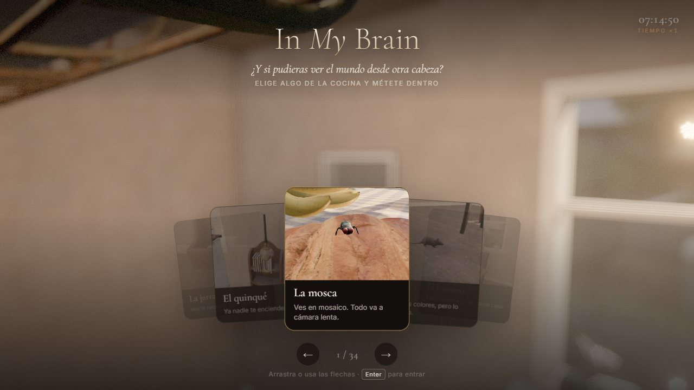
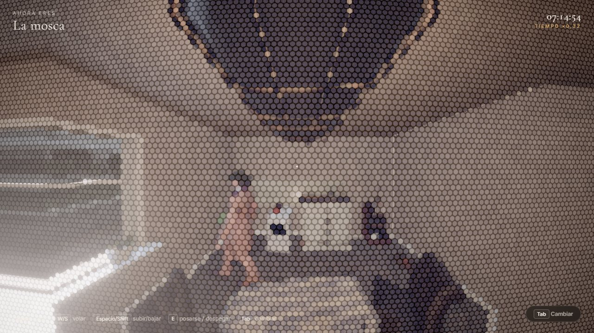
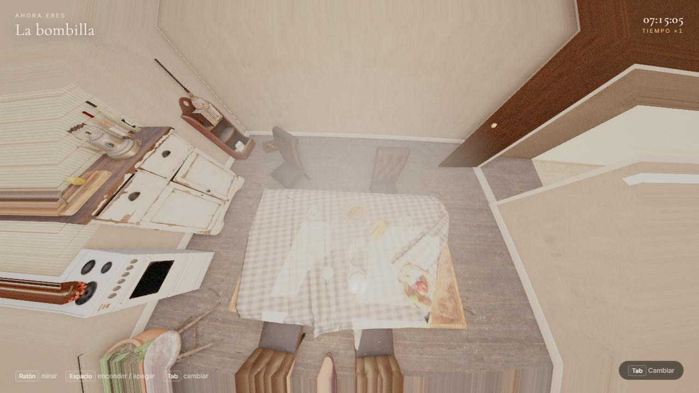

<div align="center">

# In My Brain

**¿Y si pudieras ver el mundo desde otra cabeza?**
Una cocina, un martes a las 7:14. Métete en la cabeza de cualquier cosa de la escena y vive la misma mañana desde su percepción.

[](https://virtuanista.github.io/in-my-brain/)




</div>

## Qué es

Un juego experimental en el que no eres una persona. Eliges cualquier cosa de la cocina (una mosca, la rata, la taza, el cristal, el reloj, la bombilla…) y te metes dentro. Cada una de las **34 mentes** percibe la misma escena a su manera: la mosca ve en mosaico y para ella todo va a cámara lenta, la bombilla cuelga del techo y lo mira todo desde arriba…

| La mosca | La bombilla |
|---|---|
|  |  |

## Cómo jugar

Entra en **[virtuanista.github.io/in-my-brain](https://virtuanista.github.io/in-my-brain/)**. Arrastra o usa las flechas para elegir una mente y pulsa **Enter** para entrar. Con **Tab** vuelves a elegir.

### En local

```bash
npm install
npm run dev                    # http://localhost:5173
npx vite build                 # versión estática en dist/ (la que está en GitHub Pages)
npm run build                  # versión de un solo archivo (requiere Python y Pillow)
python tools/fetch_assets.py   # vuelve a descargar los modelos de Poly Haven
```

## Curiosidades técnicas

- **Cada mente es un módulo** (`src/minds/`) que decide cómo se ve, cómo se mueve y cómo suena el mundo: cámara, filtros de imagen, velocidad del tiempo y controles.
- **El sonido se sintetiza** con Web Audio y cada mente lo oye a través de su propio «cuerpo» (filtros, velocidad, resonancias). No hay ni un archivo de audio.
- **Animación reorientada**: las animaciones de caminar y de reposo se adaptan al esqueleto del personaje humano al cargar.

## Créditos y licencias

El código es original y se publica con licencia [MIT](LICENSE). Los recursos de terceros conservan su propia licencia:

- **Modelos, texturas y HDRI**: [Poly Haven](https://polyhaven.com), CC0 (dominio público). La lista completa está en [CREDITS.md](CREDITS.md).
- **Personaje humano**: `readyplayer.me.glb`, `Xbot.glb` y `Michelle.glb` salen de los ejemplos de [three.js](https://github.com/mrdoob/three.js) (r170). Sus animaciones son originales de Mixamo (Adobe) y tienen sus propias condiciones (Mixamo y Ready Player Me).
- **Tipografías**: Cormorant Garamond e Inter (SIL Open Font License).

<details>
<summary><b>In English</b></summary>

*In My Brain* is an experimental three.js game: one kitchen, one Tuesday morning at 7:14, and 34 things you can jump into, from a fly to a light bulb, each perceiving the same scene in its own way. [Play it in your browser](https://virtuanista.github.io/in-my-brain/). The code is MIT; assets are CC0 from Poly Haven, plus characters from the three.js examples.

</details>
